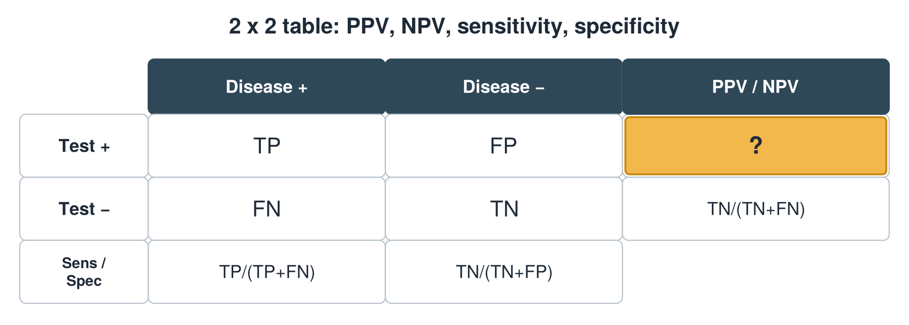
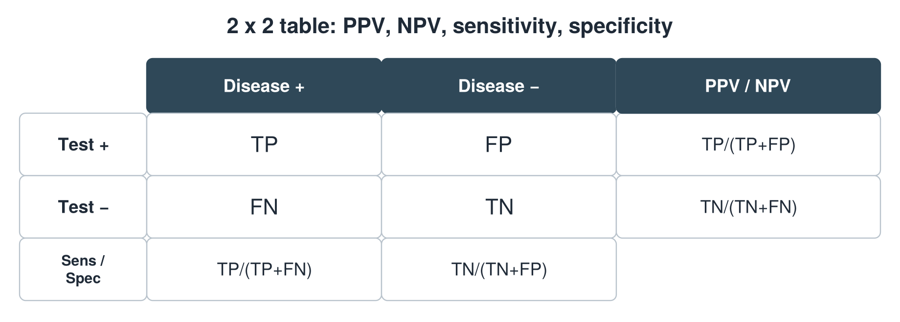

---
id    = "066d2662-6aa7-4b1c-9b35-47510e03bc13"
model = "Basic"
tags  = ["phmd205c", "lab-techniques"]
---

## Front

2 x 2 table: what formula is hidden?

## Back

PPV = TP/(TP+FP)

## Extra

Original diagram made for this deck.

Source: PHMD 205C, Clinical Laboratory Techniques and Analysis.
