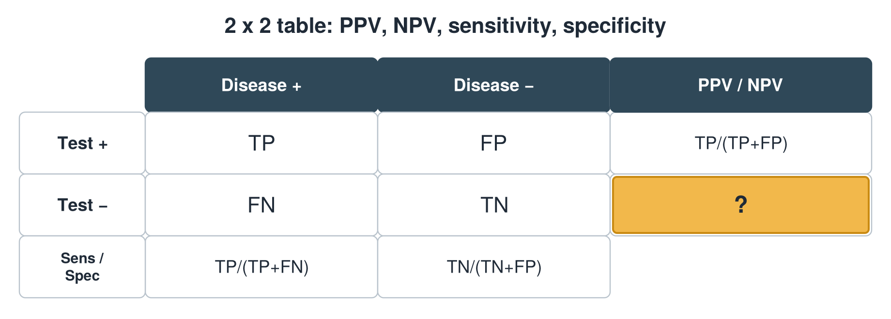
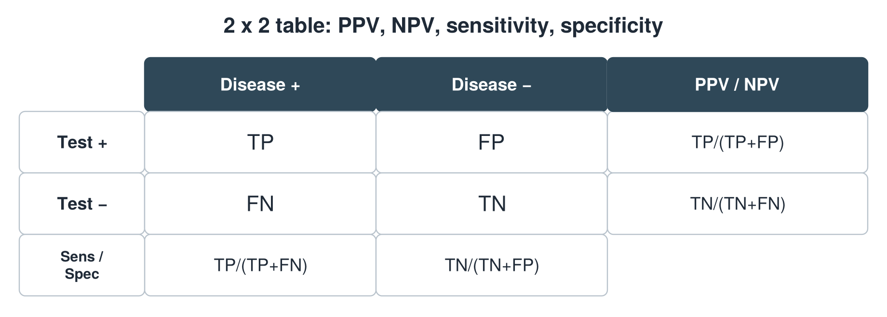

---
id    = "18a850a9-f3b0-4c10-a7af-847191ab8f88"
model = "Basic"
tags  = ["phmd205c", "lab-techniques"]
---

## Front

2 x 2 table: what formula is hidden?

## Back

NPV = TN/(TN+FN)

## Extra

Original diagram made for this deck.

Source: PHMD 205C, Clinical Laboratory Techniques and Analysis.
