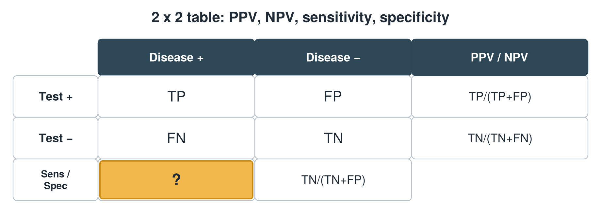
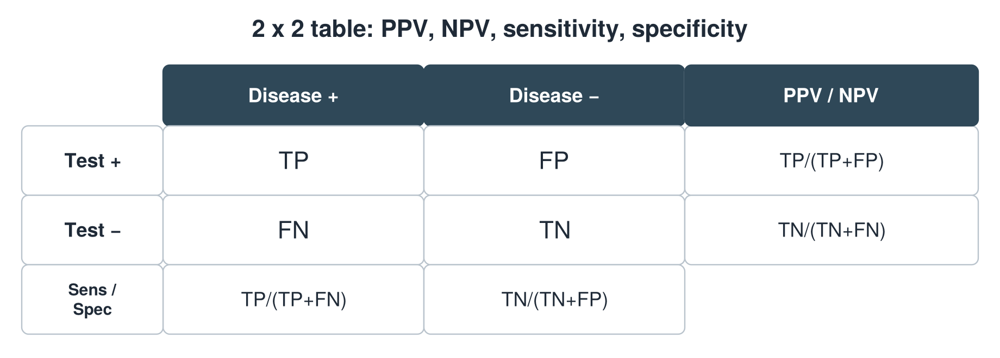

---
id    = "5dd86f77-d70a-476e-9861-e94d6c5a0835"
model = "Basic"
tags  = ["phmd205c", "lab-techniques"]
---

## Front

2 x 2 table: what formula is hidden?

## Back

Sensitivity = TP/(TP+FN)

## Extra

Original diagram made for this deck.

Source: PHMD 205C, Clinical Laboratory Techniques and Analysis.
