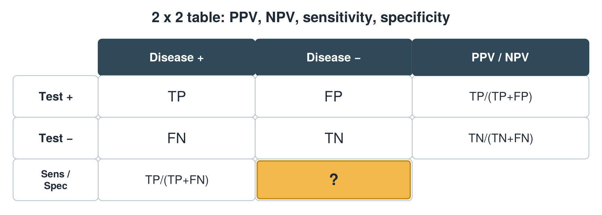
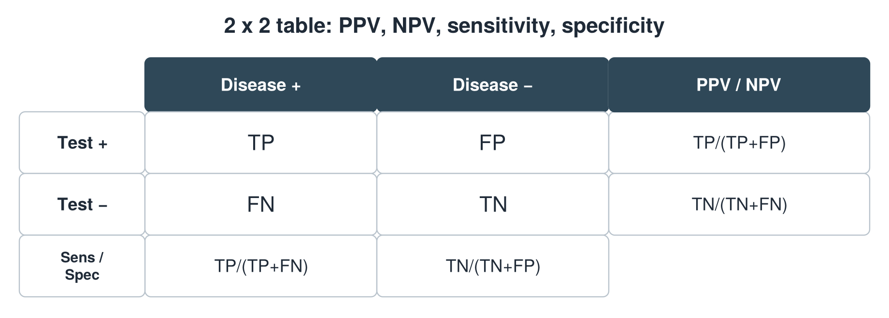

---
id    = "67b7169b-74af-4b9e-b44b-8129379ca9c1"
model = "Basic"
tags  = ["phmd205c", "lab-techniques"]
---

## Front

2 x 2 table: what formula is hidden?

## Back

Specificity = TN/(TN+FP)

## Extra

Original diagram made for this deck.

Source: PHMD 205C, Clinical Laboratory Techniques and Analysis.
