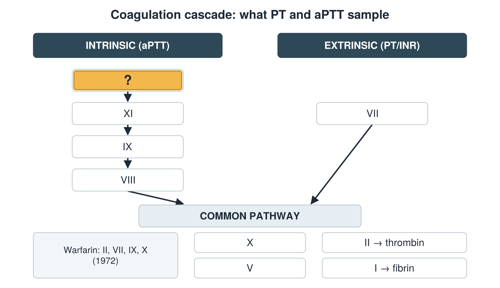

---
id    = "403e860e-dc09-4f8a-81e0-a7ad5912a422"
model = "Basic"
tags  = ["phmd205c", "cbc-coag"]
---

## Front

Coagulation cascade: which factor is hidden?

## Back

XII

## Extra

Original diagram made for this deck.

Source: PHMD 205C, Complete Blood Count and Coagulation.
