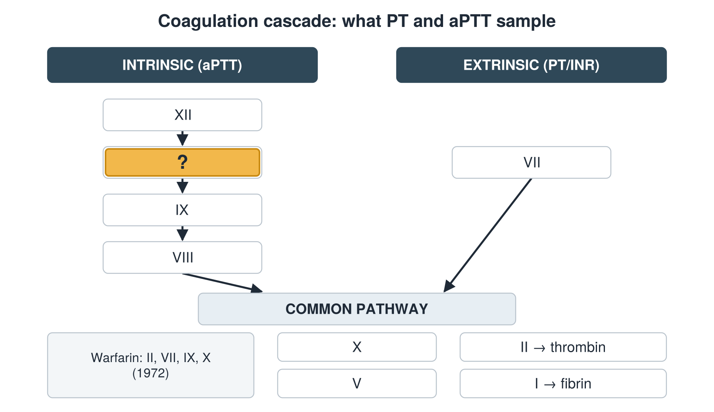

---
id    = "7b1f1a63-de87-4782-9ca3-3c134d0da0eb"
model = "Basic"
tags  = ["phmd205c", "cbc-coag"]
---

## Front

Coagulation cascade: which factor is hidden?

## Back

XI

## Extra

Original diagram made for this deck.

Source: PHMD 205C, Complete Blood Count and Coagulation.
