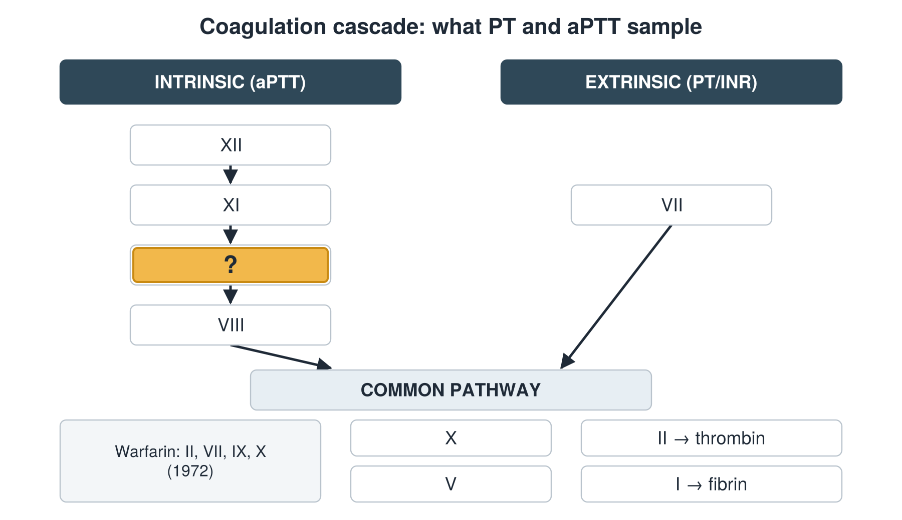
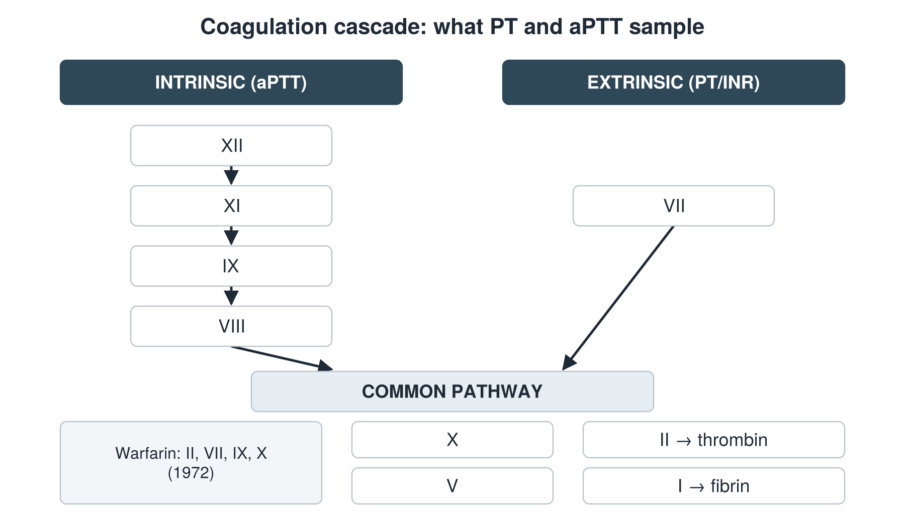

---
id    = "25819770-ad83-4a8a-afee-9548ccd4673a"
model = "Basic"
tags  = ["phmd205c", "cbc-coag"]
---

## Front

Coagulation cascade: which factor is hidden?

## Back

IX

## Extra

Original diagram made for this deck.

Source: PHMD 205C, Complete Blood Count and Coagulation.
