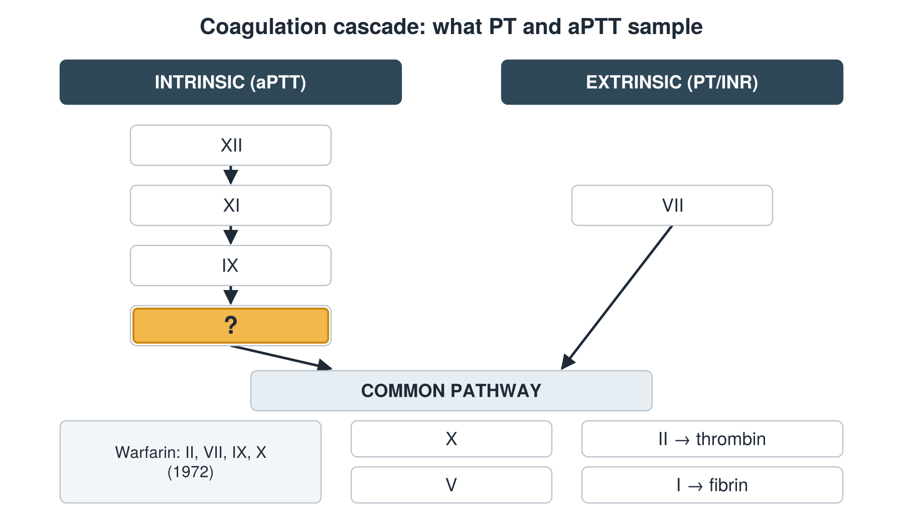

---
id    = "b1d5e0a0-52b2-4c40-9456-31923b7bd9e7"
model = "Basic"
tags  = ["phmd205c", "cbc-coag"]
---

## Front

Coagulation cascade: which factor is hidden?

## Back

VIII

## Extra

Original diagram made for this deck.

Source: PHMD 205C, Complete Blood Count and Coagulation.
