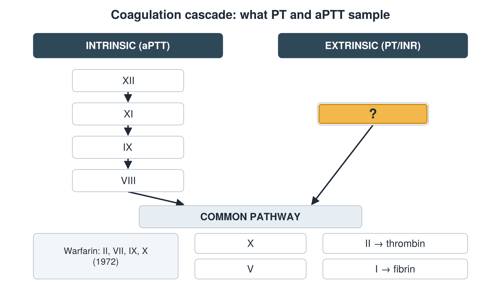

---
id    = "8993d386-8feb-483f-b8d8-338166555084"
model = "Basic"
tags  = ["phmd205c", "cbc-coag"]
---

## Front

Coagulation cascade: which factor is hidden?

## Back

VII

## Extra

Original diagram made for this deck.

Source: PHMD 205C, Complete Blood Count and Coagulation.
