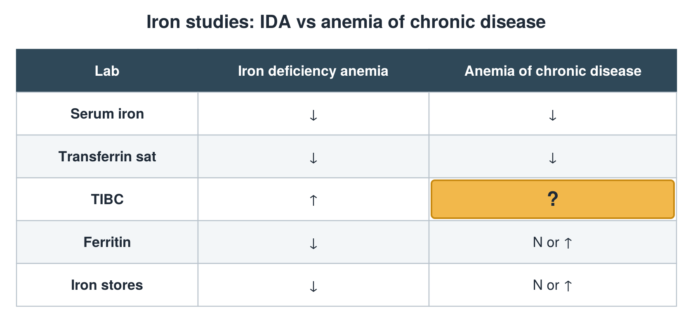

---
id    = "110d5205-425b-4dcc-901c-5d598ffcf730"
model = "Basic"
tags  = ["phmd205c", "iron-vitamins"]
---

## Front

Iron studies, IDA vs ACD: what is hidden?

## Back

N or ↓

## Extra

Original diagram made for this deck.

Source: PHMD 205C, Iron Labs, Nutritional Status and Vitamin Labs.
