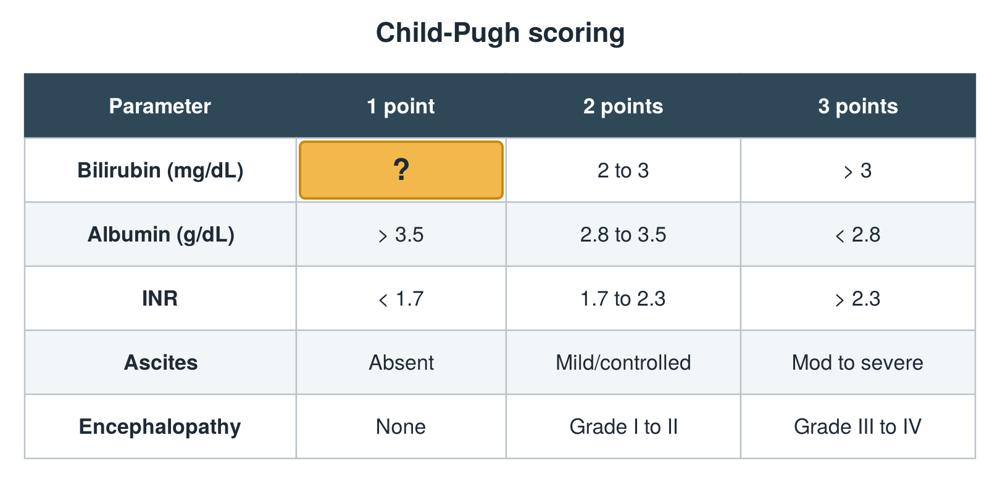

---
id    = "5729cfb6-18f3-4c69-83df-b8d26a92e18e"
model = "Basic"
tags  = ["phmd205c", "liver"]
---

## Front

Child-Pugh table: what is hidden?

## Back

< 2

## Extra

Original diagram made for this deck.

Source: PHMD 205C, Liver Function Tests.
