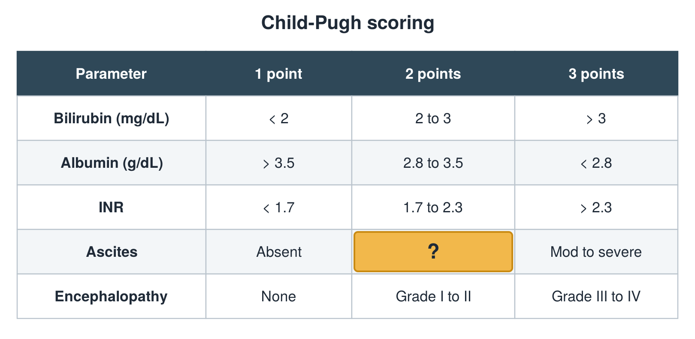

---
id    = "a3f2a5c0-3d8a-443f-a047-16a8f84b93a5"
model = "Basic"
tags  = ["phmd205c", "liver"]
---

## Front

Child-Pugh table: what is hidden?

## Back

Mild/controlled

## Extra

Original diagram made for this deck.

Source: PHMD 205C, Liver Function Tests.
