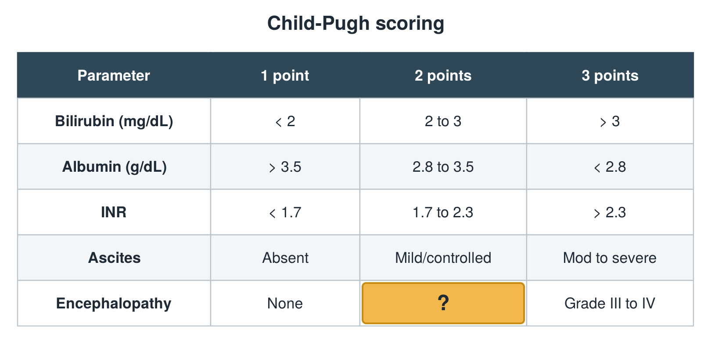

---
id    = "09d4a362-2d13-4f59-8fc4-4d63902c760d"
model = "Basic"
tags  = ["phmd205c", "liver"]
---

## Front

Child-Pugh table: what is hidden?

## Back

Grade I to II

## Extra

Original diagram made for this deck.

Source: PHMD 205C, Liver Function Tests.
