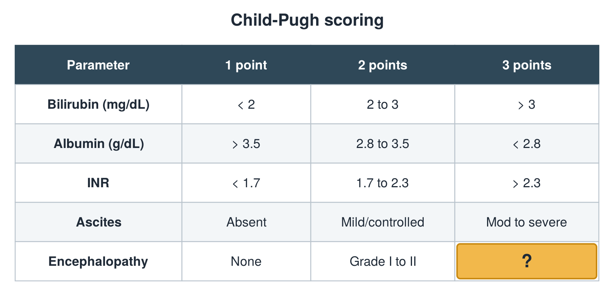

---
id    = "0ead1c58-0413-413e-8e85-cceaa757bfa4"
model = "Basic"
tags  = ["phmd205c", "liver"]
---

## Front

Child-Pugh table: what is hidden?

## Back

Grade III to IV

## Extra

Original diagram made for this deck.

Source: PHMD 205C, Liver Function Tests.
