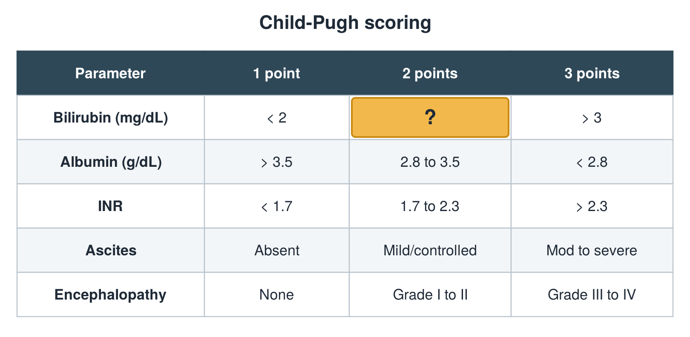
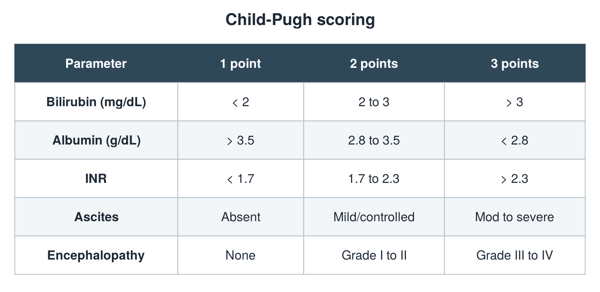

---
id    = "5158cfa6-1e01-4637-b238-4cab8aaffff8"
model = "Basic"
tags  = ["phmd205c", "liver"]
---

## Front

Child-Pugh table: what is hidden?

## Back

2 to 3

## Extra

Original diagram made for this deck.

Source: PHMD 205C, Liver Function Tests.
