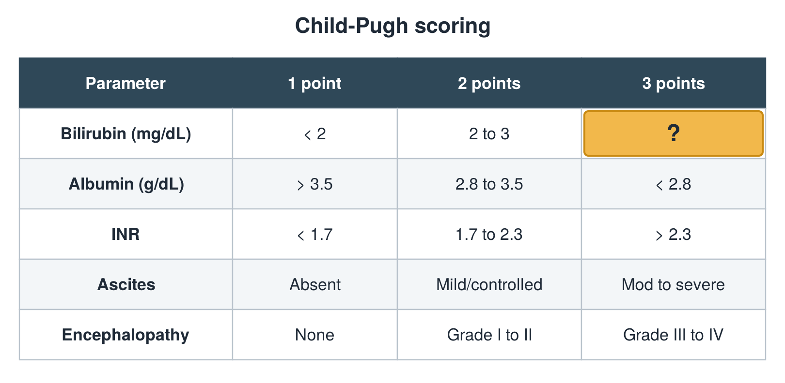

---
id    = "682ef5b0-d986-4f6a-9246-be40792eea93"
model = "Basic"
tags  = ["phmd205c", "liver"]
---

## Front

Child-Pugh table: what is hidden?

## Back

> 3

## Extra

Original diagram made for this deck.

Source: PHMD 205C, Liver Function Tests.
