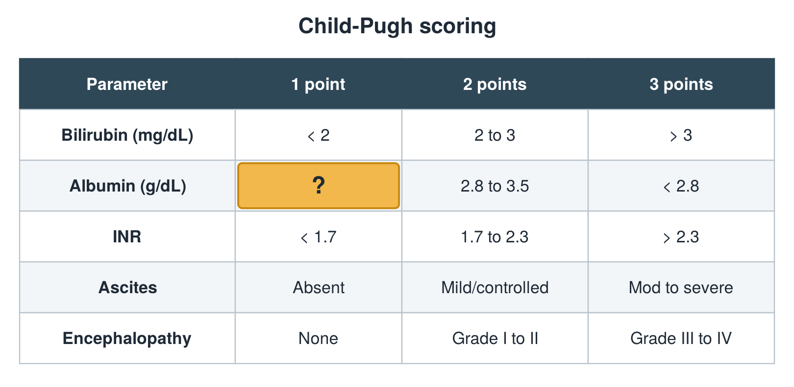

---
id    = "fac1756c-b5fa-4c3d-b3d6-5b51b82fba30"
model = "Basic"
tags  = ["phmd205c", "liver"]
---

## Front

Child-Pugh table: what is hidden?

## Back

> 3.5

## Extra

Original diagram made for this deck.

Source: PHMD 205C, Liver Function Tests.
