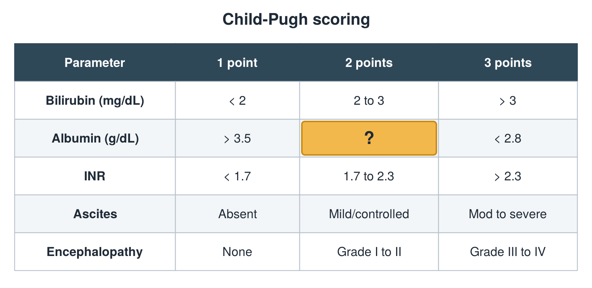

---
id    = "1ece1e0e-fe7e-49f2-b2f0-62af23ab4c78"
model = "Basic"
tags  = ["phmd205c", "liver"]
---

## Front

Child-Pugh table: what is hidden?

## Back

2.8 to 3.5

## Extra

Original diagram made for this deck.

Source: PHMD 205C, Liver Function Tests.
