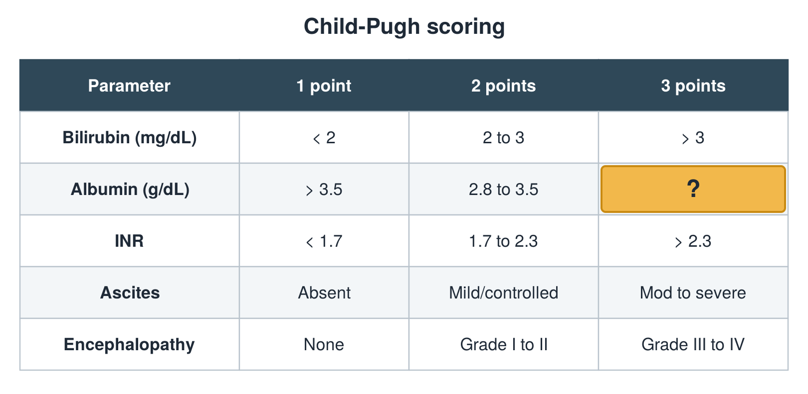

---
id    = "ebc544d1-903a-4d8d-aa51-46c4e7f08ca3"
model = "Basic"
tags  = ["phmd205c", "liver"]
---

## Front

Child-Pugh table: what is hidden?

## Back

< 2.8

## Extra

Original diagram made for this deck.

Source: PHMD 205C, Liver Function Tests.
