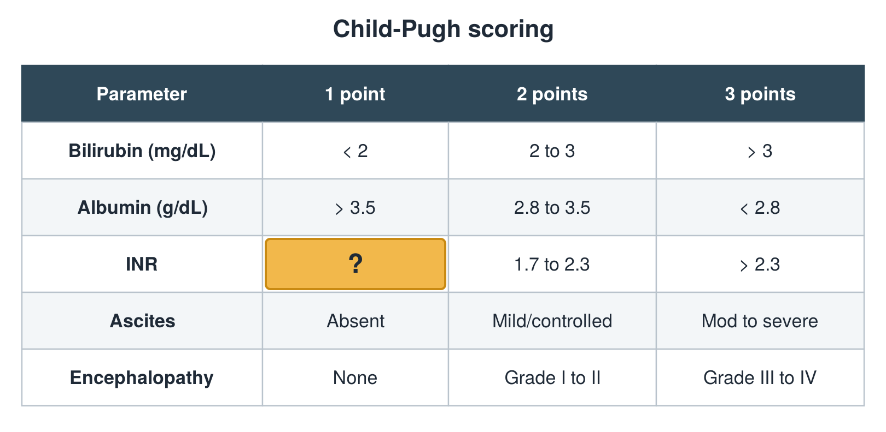

---
id    = "8f591a39-cd97-41fd-8540-f4a89a750731"
model = "Basic"
tags  = ["phmd205c", "liver"]
---

## Front

Child-Pugh table: what is hidden?

## Back

< 1.7

## Extra

Original diagram made for this deck.

Source: PHMD 205C, Liver Function Tests.
