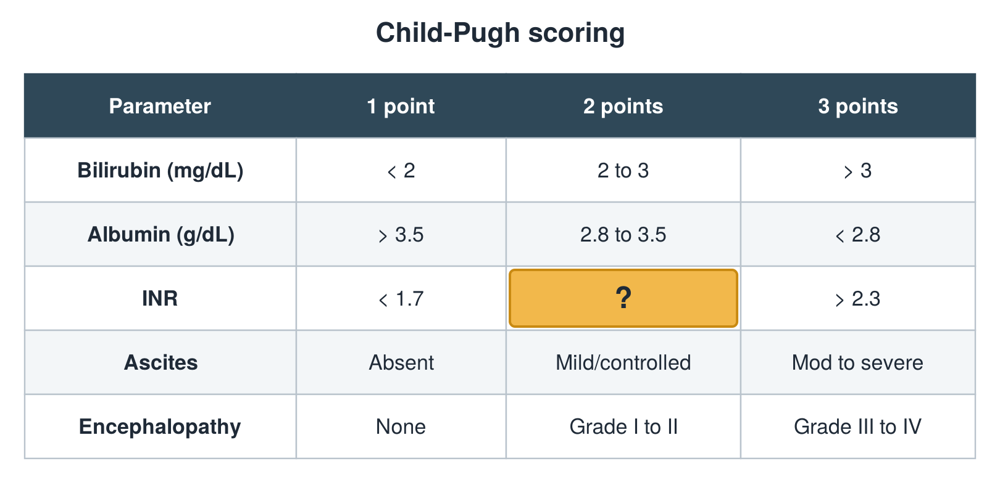

---
id    = "ccf3dc49-ff83-4b85-a745-c577e294374c"
model = "Basic"
tags  = ["phmd205c", "liver"]
---

## Front

Child-Pugh table: what is hidden?

## Back

1.7 to 2.3

## Extra

Original diagram made for this deck.

Source: PHMD 205C, Liver Function Tests.
