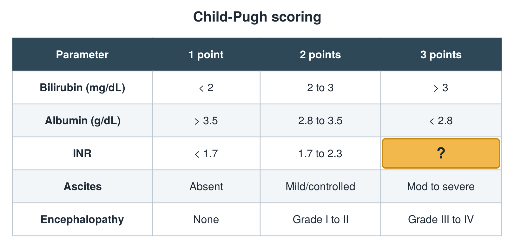

---
id    = "958db2f0-15a2-44b2-b19c-bbf1ba1c1533"
model = "Basic"
tags  = ["phmd205c", "liver"]
---

## Front

Child-Pugh table: what is hidden?

## Back

> 2.3

## Extra

Original diagram made for this deck.

Source: PHMD 205C, Liver Function Tests.
