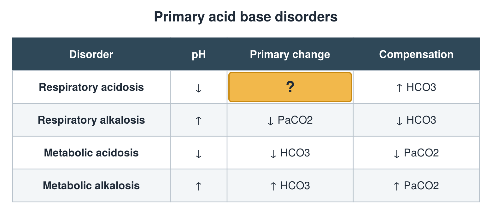

---
id    = "bac38af6-d893-44db-ab83-9176a6766e0d"
model = "Basic"
tags  = ["phmd205c", "acid-base-electrolytes"]
---

## Front

Acid base table: what is hidden?

## Back

↑ PaCO2

## Extra

Original diagram made for this deck.

Source: PHMD 205C, Acid Base and Electrolyte Disorders.
