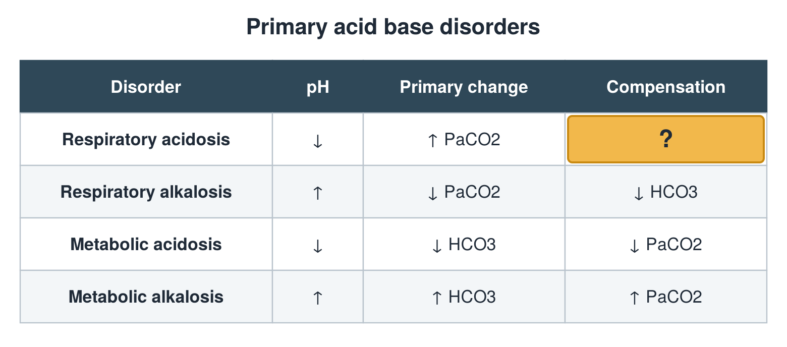

---
id    = "9bc9d94b-2241-4c12-b4a3-af99ddbdfe46"
model = "Basic"
tags  = ["phmd205c", "acid-base-electrolytes"]
---

## Front

Acid base table: what is hidden?

## Back

↑ HCO3

## Extra

Original diagram made for this deck.

Source: PHMD 205C, Acid Base and Electrolyte Disorders.
