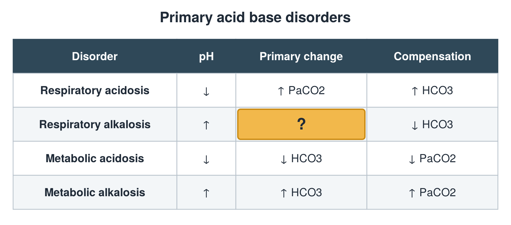
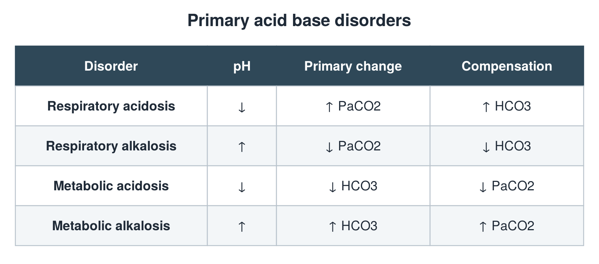

---
id    = "549983dc-d983-4068-9edd-74e978a28a39"
model = "Basic"
tags  = ["phmd205c", "acid-base-electrolytes"]
---

## Front

Acid base table: what is hidden?

## Back

↓ PaCO2

## Extra

Original diagram made for this deck.

Source: PHMD 205C, Acid Base and Electrolyte Disorders.
