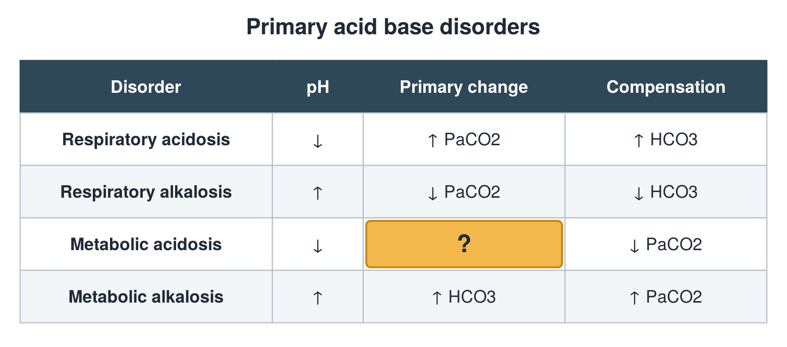

---
id    = "a37b22ad-75ec-4a18-9b6a-bc4345abb32d"
model = "Basic"
tags  = ["phmd205c", "acid-base-electrolytes"]
---

## Front

Acid base table: what is hidden?

## Back

↓ HCO3

## Extra

Original diagram made for this deck.

Source: PHMD 205C, Acid Base and Electrolyte Disorders.
