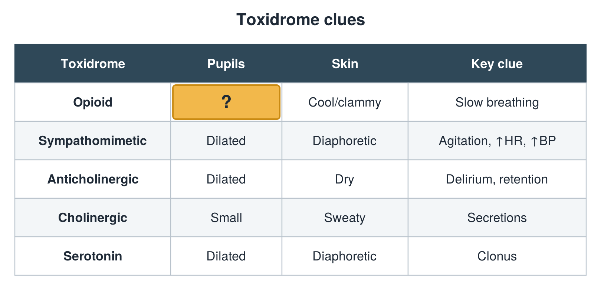
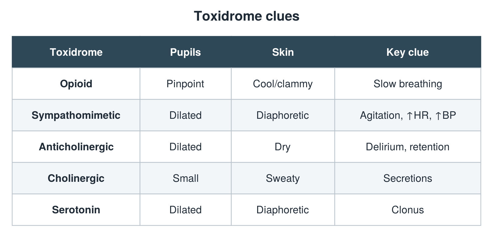

---
id    = "d64cf075-cac3-4c56-ab98-6992fe9e88e3"
model = "Basic"
tags  = ["phmd205c", "toxicology"]
---

## Front

Toxidrome table: what is hidden?

## Back

Pinpoint

## Extra

Original diagram made for this deck.

Source: PHMD 205C, Toxicology.
