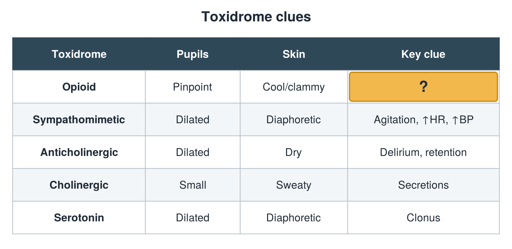

---
id    = "c9163acb-5fd7-4ab7-a8b7-57cd0d9cc243"
model = "Basic"
tags  = ["phmd205c", "toxicology"]
---

## Front

Toxidrome table: what is hidden?

## Back

Slow breathing

## Extra

Original diagram made for this deck.

Source: PHMD 205C, Toxicology.
