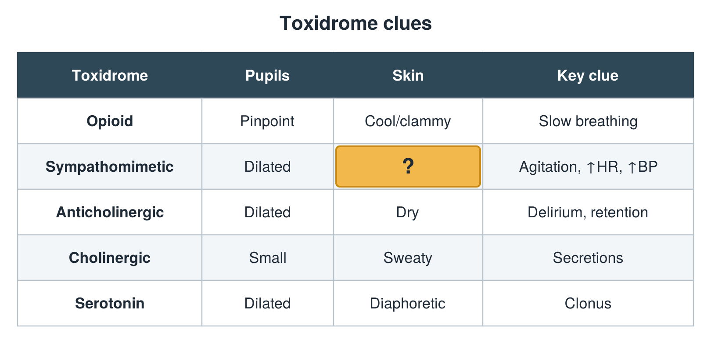

---
id    = "f62ab6e4-a14b-401f-8ec9-b1a26dfb87f1"
model = "Basic"
tags  = ["phmd205c", "toxicology"]
---

## Front

Toxidrome table: what is hidden?

## Back

Diaphoretic

## Extra

Original diagram made for this deck.

Source: PHMD 205C, Toxicology.
