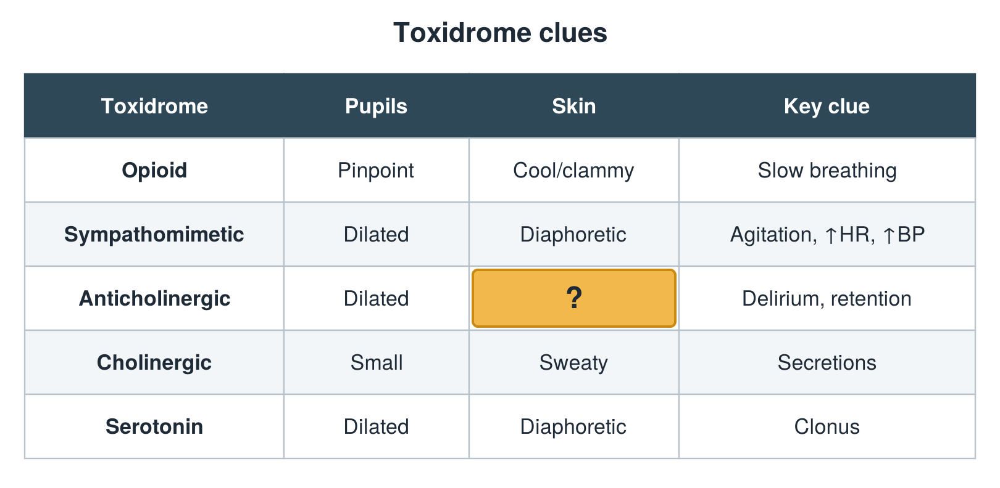

---
id    = "bb868cd7-9787-48b3-9250-c3138135ccfd"
model = "Basic"
tags  = ["phmd205c", "toxicology"]
---

## Front

Toxidrome table: what is hidden?

## Back

Dry

## Extra

Original diagram made for this deck.

Source: PHMD 205C, Toxicology.
