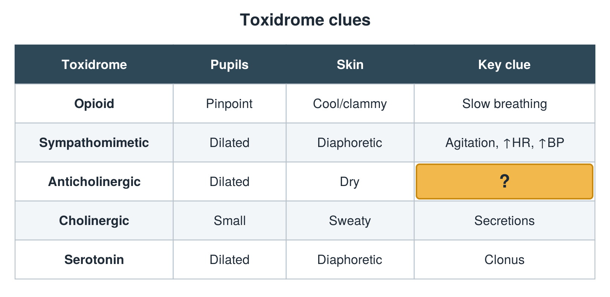

---
id    = "e9ae27a1-47a2-4e4c-86e3-f4abb65dbb2c"
model = "Basic"
tags  = ["phmd205c", "toxicology"]
---

## Front

Toxidrome table: what is hidden?

## Back

Delirium, retention

## Extra

Original diagram made for this deck.

Source: PHMD 205C, Toxicology.
