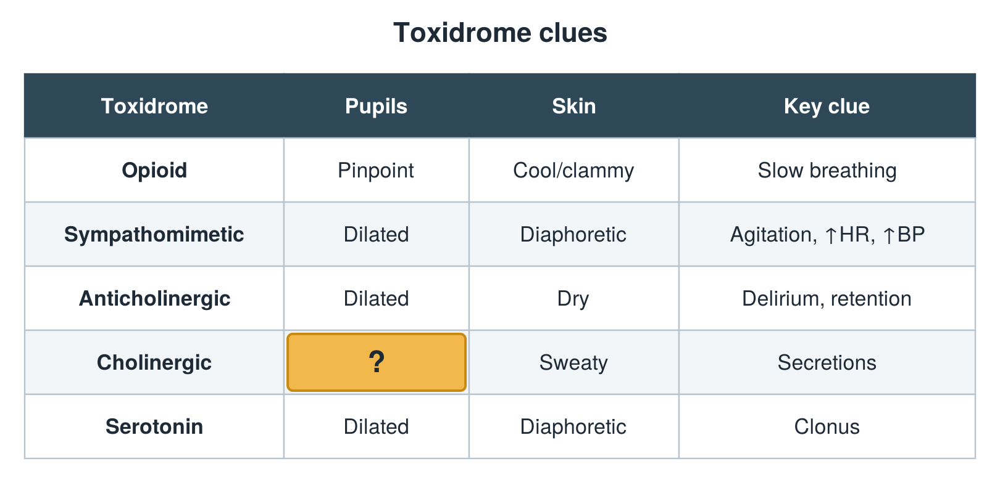

---
id    = "fba36b9e-22a7-4bef-b26c-05a6fd7420a9"
model = "Basic"
tags  = ["phmd205c", "toxicology"]
---

## Front

Toxidrome table: what is hidden?

## Back

Small

## Extra

Original diagram made for this deck.

Source: PHMD 205C, Toxicology.
