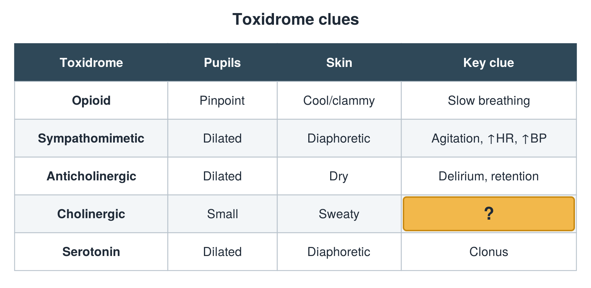

---
id    = "2cf4ee80-c7f8-4327-8e96-acfaa5c5ab27"
model = "Basic"
tags  = ["phmd205c", "toxicology"]
---

## Front

Toxidrome table: what is hidden?

## Back

Secretions

## Extra

Original diagram made for this deck.

Source: PHMD 205C, Toxicology.
