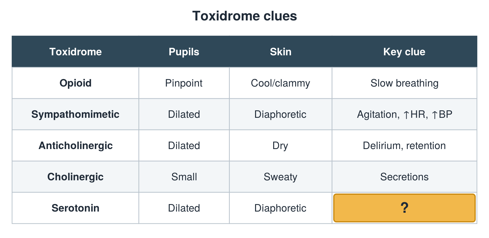

---
id    = "8440e14f-ebcd-45ab-9a58-86cf1c00b2a4"
model = "Basic"
tags  = ["phmd205c", "toxicology"]
---

## Front

Toxidrome table: what is hidden?

## Back

Clonus

## Extra

Original diagram made for this deck.

Source: PHMD 205C, Toxicology.
