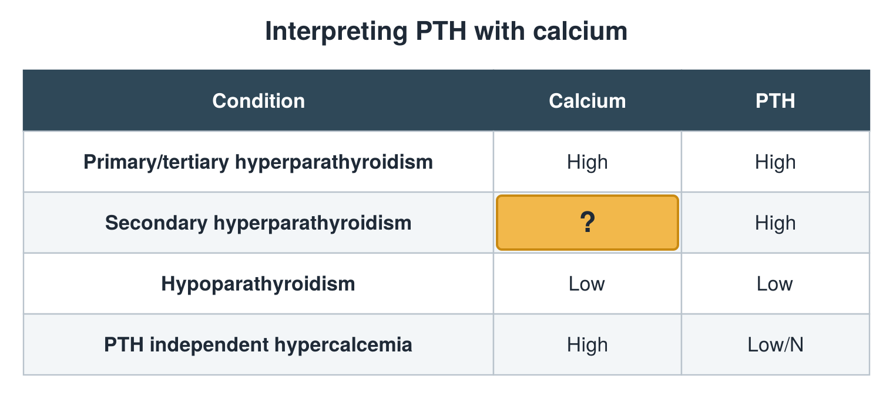

---
id    = "8068ed83-0f00-4fcb-90a1-6fb9f417d349"
model = "Basic"
tags  = ["phmd205c", "bone-mineral"]
---

## Front

PTH and calcium table: what is hidden?

## Back

Low/N

## Extra

Original diagram made for this deck.

Source: PHMD 205C, Bone and Mineral Metabolism Labs.
