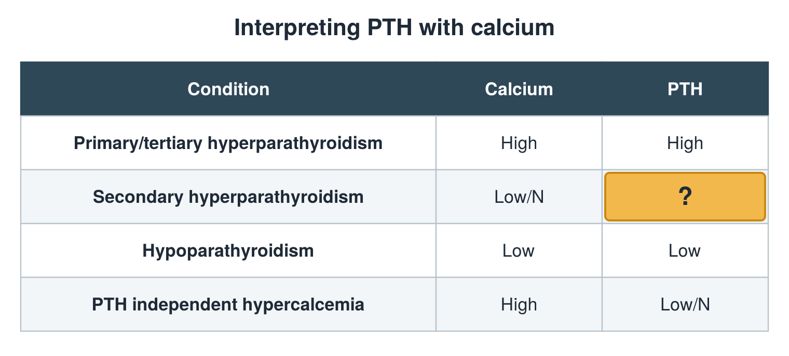

---
id    = "4aad838e-3416-4504-b3d9-16c0e2c1476e"
model = "Basic"
tags  = ["phmd205c", "bone-mineral"]
---

## Front

PTH and calcium table: what is hidden?

## Back

High

## Extra

Original diagram made for this deck.

Source: PHMD 205C, Bone and Mineral Metabolism Labs.
