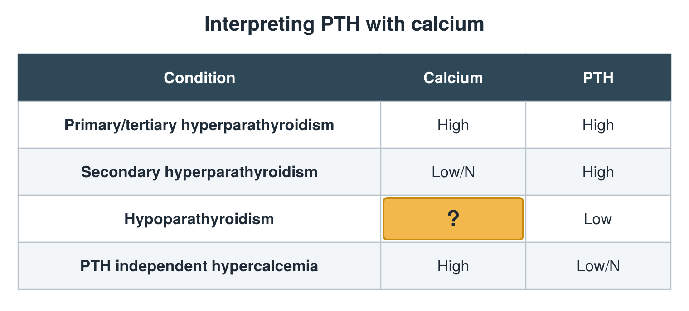
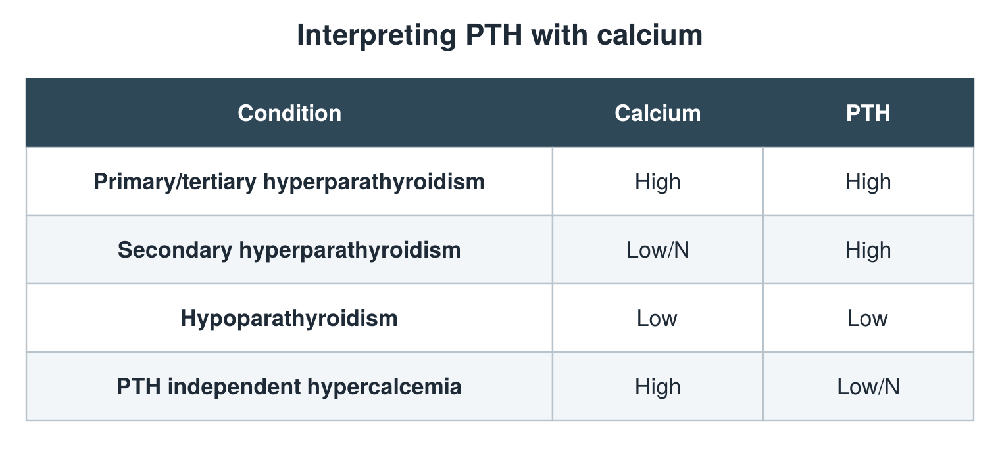

---
id    = "e0f408da-786d-4a05-804e-273cb3c13c41"
model = "Basic"
tags  = ["phmd205c", "bone-mineral"]
---

## Front

PTH and calcium table: what is hidden?

## Back

Low

## Extra

Original diagram made for this deck.

Source: PHMD 205C, Bone and Mineral Metabolism Labs.
