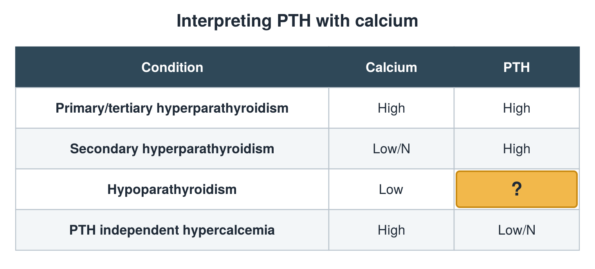

---
id    = "0938c7e4-96ca-47ee-b1e8-41070801aacf"
model = "Basic"
tags  = ["phmd205c", "bone-mineral"]
---

## Front

PTH and calcium table: what is hidden?

## Back

Low

## Extra

Original diagram made for this deck.

Source: PHMD 205C, Bone and Mineral Metabolism Labs.
