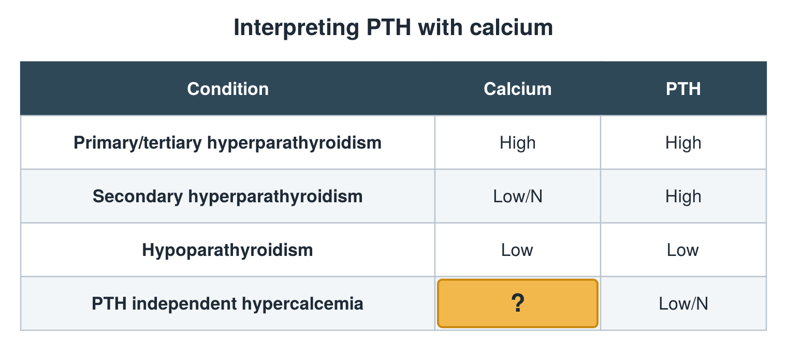

---
id    = "fe8f5bce-f225-411b-a276-01fb7df22731"
model = "Basic"
tags  = ["phmd205c", "bone-mineral"]
---

## Front

PTH and calcium table: what is hidden?

## Back

High

## Extra

Original diagram made for this deck.

Source: PHMD 205C, Bone and Mineral Metabolism Labs.
