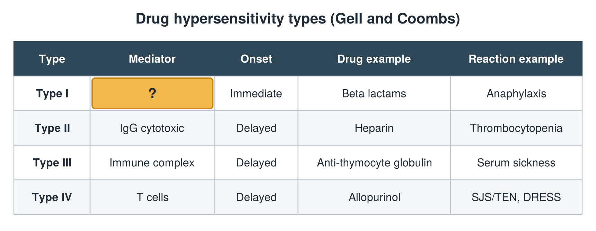

---
id    = "7300f454-a3d4-4165-b2ac-13b6f444dc5a"
model = "Basic"
tags  = ["phmd205c", "allergy-hla"]
---

## Front

Hypersensitivity types: what is hidden?

## Back

Mediator IgE / mast cells

## Extra

Original diagram made for this deck.

Source: PHMD 205C, Allergy and Human Leukocyte Antigen.
