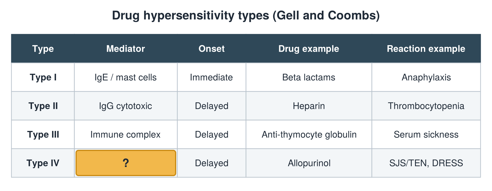

---
id    = "3229d985-9e64-4f82-80e1-88e1f3bd602f"
model = "Basic"
tags  = ["phmd205c", "allergy-hla"]
---

## Front

Hypersensitivity types: what is hidden?

## Back

Mediator T cells

## Extra

Original diagram made for this deck.

Source: PHMD 205C, Allergy and Human Leukocyte Antigen.
