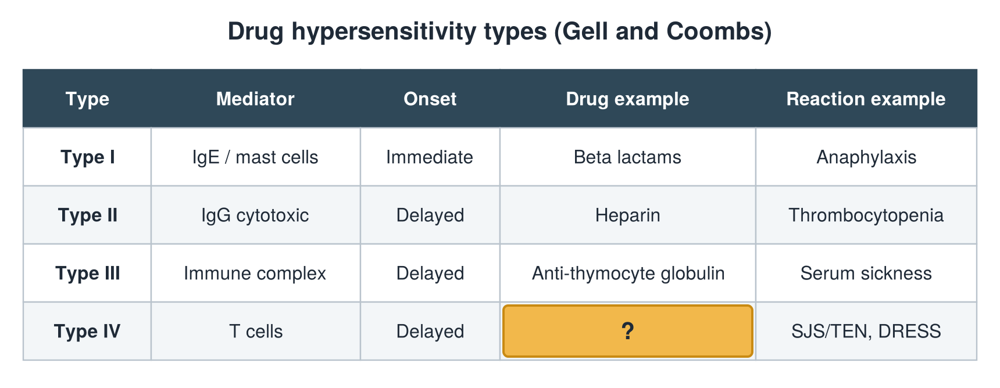

---
id    = "6b162af6-1768-4565-bac3-db2a0750adac"
model = "Basic"
tags  = ["phmd205c", "allergy-hla"]
---

## Front

Hypersensitivity types: what is hidden?

## Back

Drug example Allopurinol

## Extra

Original diagram made for this deck.

Source: PHMD 205C, Allergy and Human Leukocyte Antigen.
