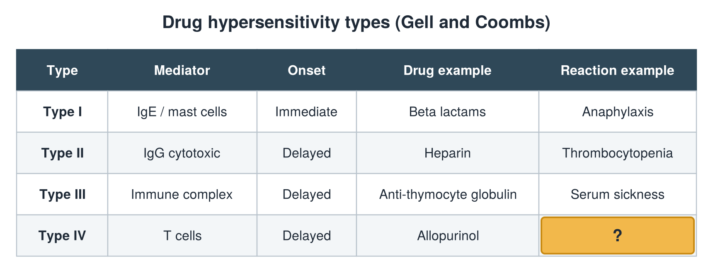

---
id    = "44fd6517-eaa1-4189-a332-a00d9090e56f"
model = "Basic"
tags  = ["phmd205c", "allergy-hla"]
---

## Front

Hypersensitivity types: what is hidden?

## Back

Reaction example SJS/TEN, DRESS

## Extra

Original diagram made for this deck.

Source: PHMD 205C, Allergy and Human Leukocyte Antigen.
