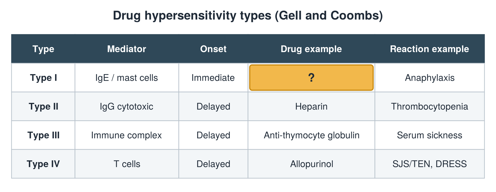

---
id    = "abf5f891-4c4d-4836-85a7-a21dd52d774e"
model = "Basic"
tags  = ["phmd205c", "allergy-hla"]
---

## Front

Hypersensitivity types: what is hidden?

## Back

Drug example Beta lactams

## Extra

Original diagram made for this deck.

Source: PHMD 205C, Allergy and Human Leukocyte Antigen.
