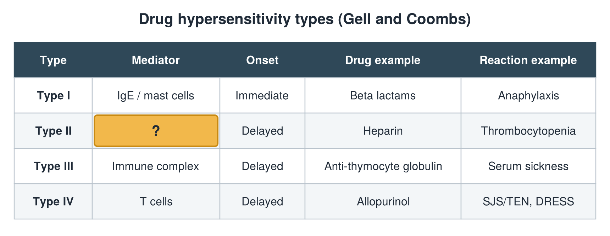

---
id    = "ef95b6bb-fe7e-4c78-ac0d-3b452d4df043"
model = "Basic"
tags  = ["phmd205c", "allergy-hla"]
---

## Front

Hypersensitivity types: what is hidden?

## Back

Mediator IgG cytotoxic

## Extra

Original diagram made for this deck.

Source: PHMD 205C, Allergy and Human Leukocyte Antigen.
