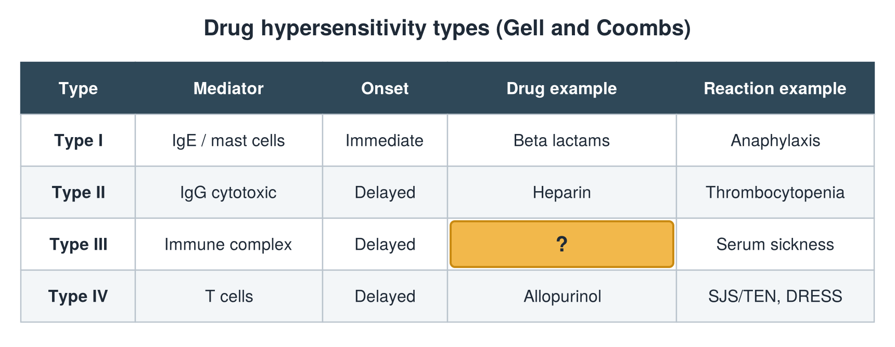

---
id    = "03932e17-8621-44b5-83dc-f9ab85af3976"
model = "Basic"
tags  = ["phmd205c", "allergy-hla"]
---

## Front

Hypersensitivity types: what is hidden?

## Back

Drug example Anti-thymocyte globulin

## Extra

Original diagram made for this deck.

Source: PHMD 205C, Allergy and Human Leukocyte Antigen.
