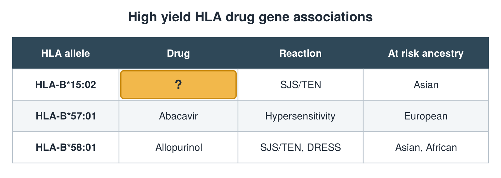

---
id    = "42cd7d15-bd9e-419c-a706-4312b8894fd6"
model = "Basic"
tags  = ["phmd205c", "allergy-hla"]
---

## Front

HLA drug gene table: what is hidden?

## Back

Drug Carbamazepine

## Extra

Original diagram made for this deck.

Source: PHMD 205C, Allergy and Human Leukocyte Antigen.
