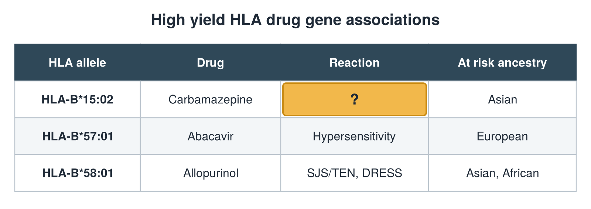

---
id    = "ce295b22-0bb7-42e2-a439-bb91547ee030"
model = "Basic"
tags  = ["phmd205c", "allergy-hla"]
---

## Front

HLA drug gene table: what is hidden?

## Back

Reaction SJS/TEN

## Extra

Original diagram made for this deck.

Source: PHMD 205C, Allergy and Human Leukocyte Antigen.
