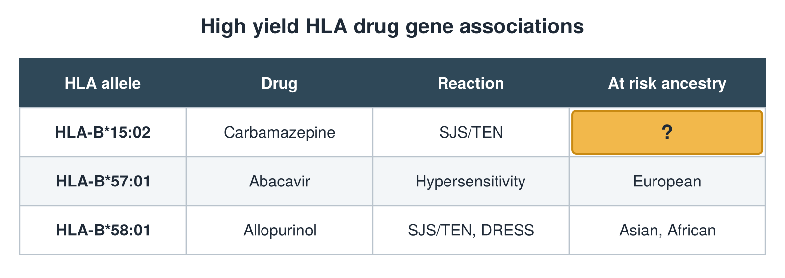
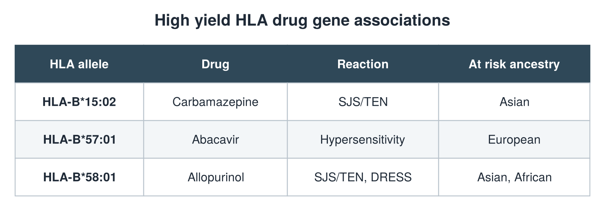

---
id    = "0fece35a-5dac-4b3a-b83e-b90898dfc70b"
model = "Basic"
tags  = ["phmd205c", "allergy-hla"]
---

## Front

HLA drug gene table: what is hidden?

## Back

At risk ancestry Asian

## Extra

Original diagram made for this deck.

Source: PHMD 205C, Allergy and Human Leukocyte Antigen.
