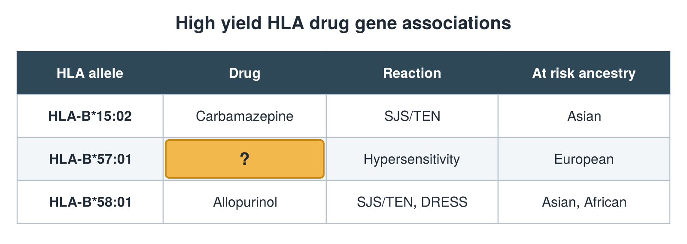

---
id    = "41b64da3-fdc4-40a8-85d8-7f731a950cd1"
model = "Basic"
tags  = ["phmd205c", "allergy-hla"]
---

## Front

HLA drug gene table: what is hidden?

## Back

Drug Abacavir

## Extra

Original diagram made for this deck.

Source: PHMD 205C, Allergy and Human Leukocyte Antigen.
